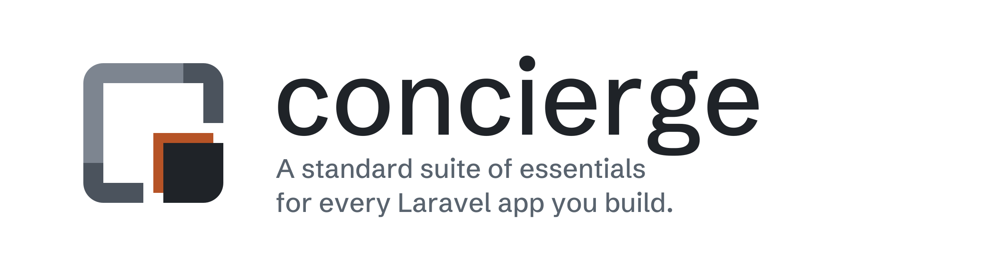

# Concierge brand kit

The mark is **Nook**: the app is the whole square, drawn as a frame left open
at its bottom-right corner, and concierge is the piece that sits in that
corner, out of the way until needed. Its Tey orange shadow falls up and to the
left, into the app: the quiet caretaker, just touching the thing it looks
after.



## Source of truth

**[`build.mjs`](build.mjs)** produces every file in [`kit/`](kit/), the review
page [`review.html`](review.html), and (once the docs site exists) the copies
deployed to `../docs/public/`. Don't edit the outputs; change the script and
rebuild:

```bash
cd brand
npm install
npm run build
```

The script holds the mark's geometry, the Grey palette, the wordmark, and the
layouts for the banner and share card. Each mark is generated at the pixel size
it's used at, so every edge lands on a whole pixel at 16, 24, 32 and 48 px.

The wordmark and all text on the banner and share card are drawn as outlines
from the fonts in [`fonts/`](fonts/), so they render the same everywhere:

| font | used for | licence |
|---|---|---|
| Schibsted Grotesk Medium | the lowercase “concierge” wordmark, taglines and the site address | [OFL 1.1](fonts/OFL-SchibstedGrotesk.txt) |
| IBM Plex Mono Regular | the install commands on the share card | [OFL 1.1](fonts/OFL-IBMPlexMono.txt) |

Both are the same files mod's kit uses.

## The mark

Drawn on a 16-unit grid with one unit of clear space on each side, so the
square spans 1 to 15.

| part | geometry | tone on white | tone on dark |
|---|---|---|---|
| far arm | the frame's left and top edges, round the top-left corner | step 2, `#7D8590` | step 2, `#8D96A0` |
| near arms | the frame's two ends that meet the corner piece; the colour changes mid-edge, at 11 | step 1, `#4B535D` | step 1, `#C2C9D1` |
| corner piece | 9 to 15, outer corner radius 2 | step 0, `#1F2328` | step 0, `#FFFFFF` |
| **shadow** | the corner piece moved 1 unit up and left | **Tey orange** | **Tey orange** |

- **The frame** is 2 units wide with outer corners of radius 2 and square inner
  corners. It stops at 7 on the bottom and right edges, leaving a 1-unit gap
  before the shadow.
- **The ramp** runs from the app's far corner (quietest) to concierge's corner
  (strongest). Because the colour changes mid-edge, the near arms read as two
  darker patches at opposite corners; that is intended.
- **Pixel grid:** at N pixels the square spans 14/16 N and every coordinate is
  rounded to a whole pixel. 16, 32 and 48 are exact; at 24 (the docs header)
  the units fall on half pixels and are rounded.
- **Mono and reversed:** in one colour the shadow would merge with the piece,
  so those files draw only its visible L, half a unit thick, with a half-unit
  gap to the piece.

## Palette: Grey

Three neutral steps with a separate ramp for each surface, plus Tey orange.
On both, step 0 has the most contrast with the surface and step 2 the least.
**There is no cream or paper anywhere in this kit**: the surfaces are white and
`#0D1117`.

| name | hex | surface | role | contrast |
|---|---|---|---|---|
| orange | `#B65326` | both | the shadow (Tey orange); one value everywhere | 4.94:1 on white, 3.83:1 on dark |
| grey 0 | `#1F2328` | light | the corner piece, the wordmark, the mono mark | 15.80:1 on white |
| grey 1 | `#4B535D` | light | the frame's near arms | 7.79:1 on white |
| grey 2 | `#7D8590` | light | the frame's far arm | 3.73:1 on white |
| white | `#FFFFFF` | dark | the corner piece and the wordmark on dark; the reversed mark; tiles | 18.92:1 on dark |
| grey 1 (dark) | `#C2C9D1` | dark | the frame's near arms | 11.33:1 on dark |
| grey 2 (dark) | `#8D96A0` | dark | the frame's far arm | 6.31:1 on dark |
| dark | `#0D1117` | | the dark surface the dark variants are drawn for | |
| muted | `#59636E` | light | taglines on white | 6.11:1 |
| muted (dark) | `#9198A1` | dark | taglines on dark | 6.50:1 |

Every tone that carries shape is at least 3:1 on its surface. **These are
brand colours, not text colours.** Don't use the Grey steps for links or body
text; the docs keep their own text colours.

## Files

All in [`kit/`](kit/).

| file | size | notes |
|---|---|---|
| `mark-light.svg` | 480 grid | for light surfaces, transparent |
| `mark-dark.svg` | 480 grid | for dark surfaces, transparent |
| `mark-mono.svg` | 480 grid | all grey 0, for print, stamps and embroidery |
| `mark-reversed.svg` | 480 grid | all white, for dark or orange fields |
| `lockup-light.svg`, `lockup-dark.svg` | 240 high | mark + “concierge”, wordmark as outlines |
| `logo-light.svg`, `logo-dark.svg` | 24 × 24 | the docs header logo, drawn on the 24 px grid |
| `favicon.svg` | 16 × 16 | follows the tab's colour scheme: the light ramp by default, the dark ramp in a dark tab; transparent |
| `favicon.ico` | 16, 32, 48 | real PNGs at each size (also `favicon-16/32/48.png`, light ramp) |
| `apple-touch-icon.png` | 180 × 180 | opaque white tile |
| `avatar-512.png`, `avatar-1000.png` | 512, 1000 | GitHub and social avatar: full-bleed white, no baked corner radius |
| `banner-light@2x.png`, `banner-dark@2x.png` | 1200 × 320 at 2× | banner on its own background (white, `#0D1117`), for places that need a solid image |
| `banner-light-transparent@2x.png`, `banner-dark-transparent@2x.png` | trimmed to the artwork | README banner, no background; switch them with `<picture>` and link them with `?v=N`, as mod's README does |
| `og-image.jpg` | 2400 × 1200, ~80 KB | share card (`og:image`) |
| `favicon-check.png` | | the favicon at 16 and 32 px on white, light grey and two dark tab colours, at 8× |

### The favicon at 16 px

At 16 px the shadow is a 1 px orange L between the gap and the corner piece.
It still reads on white, light grey and both dark tab colours (see
`favicon-check.png`), so the favicon uses the full mark at every size.

### The share card

The mark and name, large, with the tagline, the install command in orange, and
the rest of concierge's real install sequence from its README, faded to 0.52
so it stays visible in print and on projectors. The name stays legible at the
255 px thumbnail LinkedIn uses. If the install steps change, update `INSTALL`
in `build.mjs` and rebuild.

The tagline is “A standard suite of essentials for every Laravel app you
build.” It's `TAGLINE` in `build.mjs`: one line on the share card, wrapped onto
two beside the mark on the banners. Change it there and rebuild.

## Deployed copies

Once the docs site exists in `../docs/`, `npm run build` copies these into
`../docs/public/`: `favicon.svg`, `favicon.ico`, `apple-touch-icon.png`,
`og-image.jpg`, `logo-light.svg` and `logo-dark.svg`. Until then the step is
skipped.

The site should link them with `?v=1`. **When a deployed file changes, bump
`?v=` there** (and `ASSET_VERSION` in `build.mjs`, which records it): the CDN
caches icons and images for hours.

## Rules

- **The orange is always the shadow**, falling one unit up and left from the
  corner piece into the app. Don't move it, recolour it, or add orange anywhere
  else in the mark.
- **One orange value everywhere**, `#B65326`, on light and dark.
- **No cream.** Light surfaces are white; the dark surface is `#0D1117`.
- **Use the ramp for the surface**: `mark-light` on light, `mark-dark` on dark.
  On a busy or coloured field, use `mark-mono` or `mark-reversed`.
- **Keep the gap** between the frame's ends and the corner piece: it is what
  makes the corner piece concierge's, not part of the app.
- **Don't redraw the wordmark in live text.** Use the lockup files; they're
  outlines.
- **Opaque tiles have square corners.** GitHub, social sites and iOS mask them.
- **The mark is original.** It isn't based on any third-party kit, and nothing
  here may be replaced with Tailwind Plus or other licensed components.

Every export at 16, 24, 32 and 48 px and large, on white and dark, is in
[`review.html`](review.html).
